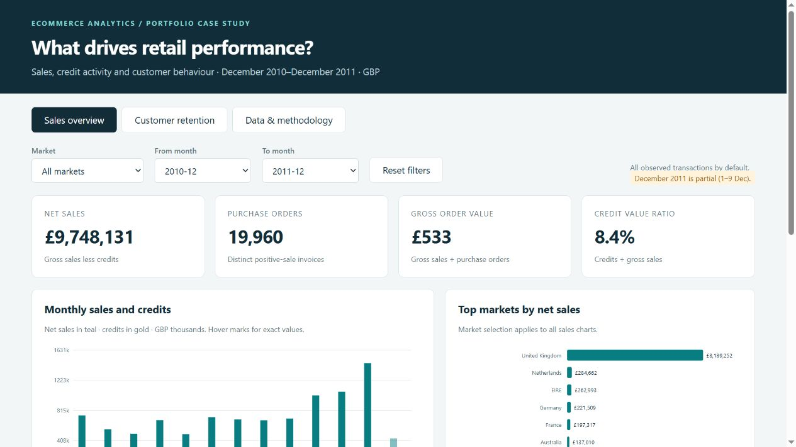

# Online Retail Analytics

A portfolio project showing how transaction data can support sales planning, credit investigation and customer retention. Built with Python, pandas, SQLite, SQL and an offline interactive dashboard.



## Start here

Open **dashboard/index.html** in your browser. It works offline without installation or a server. Explore sales by country and month, then switch to customer retention or data methodology. Customer analysis uses the full observed window and does not change with the sales filters.

Read **reports/CASE_STUDY.md** for findings and recommendations. **reports/UPWORK_PORTFOLIO.md** contains ready-to-adapt portfolio copy and an attachment guide. This is an independent project, not a client engagement.

## Business questions

1. Which periods, markets and products contribute the most net sales?
2. How much positive sales value is offset by credits?
3. How concentrated is identified customer spending?
4. Which customer groups are candidates for retention experiments?

## Reproduce the analysis

Use Python 3.11 or newer. From this project directory:

```powershell
python -m venv .venv-portfolio
.\.venv-portfolio\Scripts\python.exe -m pip install -r requirements.txt
.\.venv-portfolio\Scripts\python.exe src/analyze.py --input "data/Online Retail.xlsx"
.\.venv-portfolio\Scripts\python.exe -m unittest discover -s tests -v
```

The pipeline reads the original file without modifying it, writes processed CSVs and `data/retail.sqlite`, runs all eight SQL analyses, and rebuilds the dashboard, metrics, audit and case study. Dashboard screenshots and portfolio artwork are presentation snapshots and should be recaptured if data changes. `notebooks/02_portfolio_analysis.ipynb` presents the verified outputs; rerun its cells after rebuilding data. Install Jupyter separately if you want an interactive notebook editor.

## Project contents

| Path | Purpose |
|---|---|
| src/analyze.py | Data validation, cleaning, aggregation, segmentation, cohorts and report generation |
| sql/analysis.sql | Eight executable SQLite analyses including windows, CTEs and conditional aggregation |
| notebooks/02_portfolio_analysis.ipynb | Executed analytical walkthrough |
| dashboard/index.html | Self-contained dashboard with month and market filters |
| data/processed/ | Reusable CSV tables, including transaction and customer models |
| reports/ | Case study, Upwork copy, metrics, audit, SQL outputs and portfolio images |
| tests/ | Synthetic boundary and financial reconciliation tests |

## Analytical choices

Exact duplicate rows are removed as an explicit assumption, with the monetary sensitivity reported. Nonpositive prices, invalid dates and zero quantities are excluded. Negative quantities are retained as credits. Missing CustomerID values remain in sales totals and are excluded from customer analyses. No outliers are removed. Overall sales include special codes; merchandise rankings apply a documented stock-code heuristic.

Gross AOV uses positive sales divided by purchase invoices. Credits are not matched returns. RFM monetary value is gross historical spend, not profit or lifetime value. Segments use explainable recency/frequency thresholds. Cohort retention includes only fully observed calendar months, uses first observed purchase, and distinguishes unavailable cells from zero retention. December 2011 is partial.

## Validation

The pipeline reconciles raw rows to included, duplicate and excluded rows; raw signed value to net sales; gross sales less credits to net sales; invoice grain to dashboard aggregations; and Python KPIs to SQLite results. See `reports/data_quality.json` for the run evidence and source SHA-256. Synthetic tests cover cancellation handling, anonymous purchases, duplicate sensitivity and cohort censoring.

## Dataset and attribution

Chen, D. (2015). **Online Retail** [Dataset]. UCI Machine Learning Repository. https://doi.org/10.24432/C5BW33. [Dataset page](https://archive.ics.uci.edu/dataset/352/online-retail). Licensed under **CC BY 4.0**. Dataset changes: cleaning rules, derived fields and aggregations as documented above. Dates cover 1 December 2010 to 9 December 2011. Values are GBP.

The source workbook and bulky rebuildable data files are excluded from Git by default. Keep attribution if publishing derived data. No Upwork or GitHub publication is performed by this project.
